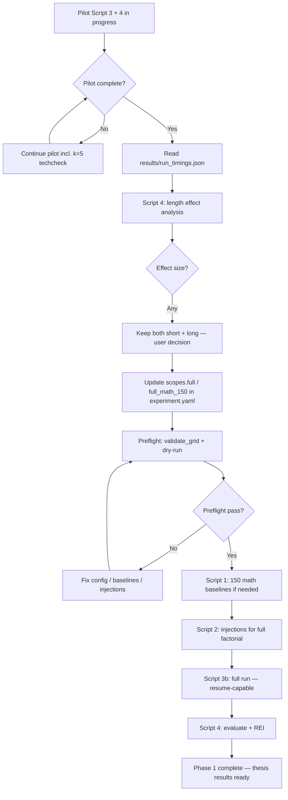
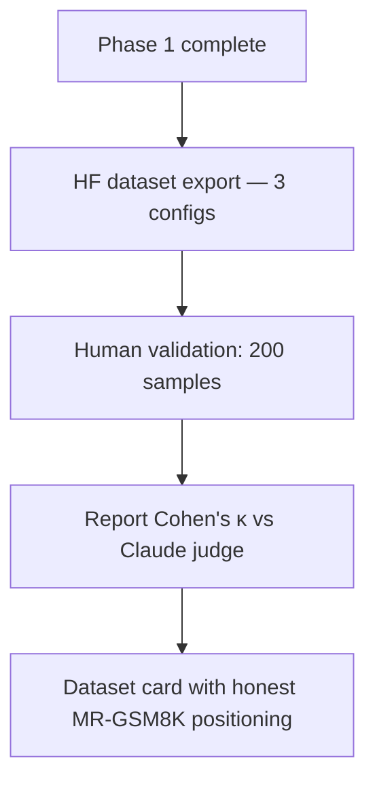

# Full Run Plan — MSc Thesis Experiment 1

**Status:** Finalized configuration (2026-06-17)  
**Hard cap:** 1.5 GPU-days (~36 h compute)  
**Primary script:** Script 3b (`scripts/run_adaptive_dialogue.py`) → Script 4 (`scripts/evaluate.py`)

---

## Phase overview

| Phase | When | Goal | Blocks GPU run? |
|-------|------|------|-----------------|
| **Phase 1 (now)** | Current work | Pilot finish → timing read → Script 4 analysis → configure `scopes.full` / `full_math_150` → preflight → full run start + evaluation | — |
| **Phase 2 (post full run)** | After successful Phase 1 | HF dataset export, human validation (200 samples + Cohen's κ), dataset card | **No** — deferred, not blocking |

> **User decision (2026-06-17):** Hold off on dataset work for now. Dataset export, HF publication, and human validation are **Phase 2** todos — not active execution items until the full run completes successfully.

---

## 1. Overview

This experiment measures **mid-CoT perturbation and recovery** in reasoning models. Each dialogue injects adversarial content at the baseline midpoint, then runs paired **stop** (short generation cap) and **recovery** (full generation) variants on the same prefix.

### 1.1 Agreed full-run configuration

| Axis | Full run | Pilot (reference) |
|------|----------|-------------------|
| Domains | **math only** (MATH-500 pool) | math + science + logic |
| Tasks | **150** | ~40 (pilot_gpu) |
| `k_injections` | **[1, 3]** | [1, 3] + k=5 techcheck |
| `length_levels` | **[short, long]** | short (+ k=5 long techcheck) |
| `seeds` | **[42, 43, 44]** | [42] |
| `error_types` | all 3 | all 3 |
| `variants` | stop + recovery (paired) | stop + recovery |

> **Decision locked:** Keep both length levels regardless of Script 4 effect size. Do **not** drop to 1 seed. Do **not** abort pilot early because of k=5.

### 1.2 Dialogue count

Each row = one `(task, error_type, k, length, seed)` cell with **paired** stop/recovery traces.

```
dialogues = tasks × error_types × k × length × seeds
          = 150 × 3 × 2 × 2 × 3
          = 5,400
```

| Component | Count |
|-----------|------:|
| Unique tasks | 150 |
| Condition cells per task | 3 × 2 × 2 × 3 = **36** |
| Total dialogues (stop+recovery pairs) | **5,400** |
| Stop traces | 5,400 |
| Recovery traces | 5,400 |
| Raw generation rows (stop + recovery) | **10,800** |

The **10,800** figure is paired traces sharing a prefix — not 10,800 independent examples. Market as **5,400 dialogues with paired stop/recovery traces**.

### 1.3 Key repository files

| File | Role |
|------|------|
| `configs/experiment.yaml` | Scope limits (`scopes.full` or new `full_math_150`) |
| `scripts/run_adaptive_dialogue.py` | Script 3b — adaptive alternating dialogues |
| `scripts/evaluate.py` | Script 4 — REI + aggregates (`rei_natural`) |
| `src/run_timings.py` | Extrapolation constant `FULL_THESIS_DIALOGUES` (line 11) |
| `results/run_timings.json` | Measured `seconds_per_dialogue` from pilot |
| `data/baseline_cots.jsonl` | Script 1 — 150 verified baselines |
| `data/injections_generated.jsonl` | Script 2 — Claude-generated injections |
| `data/adaptive_dialogues.jsonl` | Script 3b intermediate output |
| `data/complete_dialogues.jsonl` | Script 3b final dialogues |

---

## 2. Decision flow

### Phase 1 — Full run (active)



### Phase 2 — Dataset contribution (deferred)



> Phase 2 begins only after Phase 1 succeeds. None of these steps block the GPU run or full-run evaluation.

---

## 3. Configuration changes

### 3.1 Recommended: new scope `full_math_150`

Add a dedicated scope rather than overwriting the legacy multi-domain `full` block. Set `active_scope: full_math_150` before the run (or pass `--scope full_math_150`).

Insert after the existing `scopes.full` block in `configs/experiment.yaml` (currently lines 162–171):

```yaml
  full_math_150:
    description: "Thesis Exp 1 full run: MATH-500, 150 tasks, k{1,3} x short/long x 3 seeds, stop+recovery"
    # Optional: pin task pool if you build a 150-task math-only file
    # tasks: data/experiment_tasks_math150.jsonl
    max_tasks_total: 150
    max_per_domain: 150
    domains: [math]
    variants: [stop, recovery]
    error_types: [incorrect_reasoning, paraphrased_shift, off_topic]
    k_injections: [1, 3]
    length_levels: [short, long]
    seeds: [42, 43, 44]
```

**Task selection:** Either cap via `max_per_domain: 150` on the existing MATH-500 pool, or pre-build a reproducible file:

```bash
python scripts/prepare_tasks.py --config configs/datasets.yaml \
  --output data/experiment_tasks_math150.jsonl \
  --domain math --limit 150 --seed 42
```

Then uncomment `tasks: data/experiment_tasks_math150.jsonl` in the scope.

### 3.2 Alternative: modify existing `scopes.full`

Replace lines 162–171 in `configs/experiment.yaml`:

```yaml
  full:
    description: "Thesis Exp 1: math-only 150 tasks, k{1,3} x short/long x 3 seeds"
    max_tasks_total: 150
    max_per_domain: 150
    domains: [math]
    variants: [stop, recovery]
    error_types: [incorrect_reasoning, paraphrased_shift, off_topic]
    k_injections: [1, 3]
    length_levels: [short, long]
    seeds: [42, 43, 44]
```

### 3.3 Script 4 threshold alignment

With 3 seeds, `script4.min_recovery_seeds: 2` (line 254) is appropriate. With 150 tasks per condition slice, `script4.min_valid_tasks: 60` (line 261) is reachable — no change required.

### 3.4 Optional: update timing extrapolation constant

`src/run_timings.py` line 11 still assumes the old multi-domain full scope:

```python
FULL_THESIS_DIALOGUES = 240 * 3 * 3 * 2 * 5  # 21_600 — legacy scopes.full
```

Update after pilot timing is confirmed:

```python
FULL_THESIS_DIALOGUES = 150 * 3 * 2 * 2 * 3  # full_math_150: 5_400
```

### 3.5 Lean-metrics migration (Phase A/B) — pre-registered decisions

Script 4 reports the **Lean** metric set as primary; REI is demoted to a
deprecated CSV column. Implemented in `scripts/evaluate.py`,
`scripts/ensure_judge_coverage.py`, `scripts/pipeline_common.py`, and the
`script4:` block of `configs/experiment.yaml`.

Primary metrics (`eval_summary.txt`):

- **Susceptibility** = `1 - acc_stop` (gradable stop only). With intersection-verified
  math tasks `acc_clean = 1.0` by design, so Susceptibility == Accuracy Drop — report
  it **once**, not twice.
- **Recovery Gain** = `acc_recovery_all - acc_stop` (H1). Uses **all** gradable
  recovery runs (no natural-filter; `token_limit`/`extraction_failed` stay in N when judged).
- **RTER** = `(acc_recovery_all / tokens_recovery) / (acc_clean / tokens_baseline)` —
  clean-normalized, bounded token-efficiency (replaces the ~1e-4 REI).
- **TPR / persistence_rate** + **overcorrection_rate** from `recovery_decomposition.csv`.

Significance: **McNemar (exact) + Wilson CI, task-clustered** (`confirmatory_tests.csv`).
Collapses to one observation per task (≤100) before testing — the paired t-test
(`significance_tests.csv`, kept legacy) pseudoreplicates Task×Condition cells and
produced the dishonest literal `p=0.0`. p-values are never printed as `0.0` (`<1e-4`).

Stop-truncation rule (A1b, locked): a `stop` run cut off at the token cap
(`finish_reason=length`) **without a complete, closed `\boxed{...}`** is
**ungradable**, not wrong — the judge's "Incorrect" on the partial text is ignored.
Counting truncation as wrong would inflate Susceptibility/Recovery Gain (bias toward H1).
`stop_truncation_sensitivity.csv` reports the count-as-wrong sensitivity (expected ≈0 pp
on math with the 2A prefill + cap 500).

Judge-coverage HARD gate (A5): `evaluate.py` aborts when any `judge_fallback`
row remains or the per-k fallback rate is unbalanced (>5 pp). The full run drives
this to 0 via `ensure_judge_coverage.py` (judge_batch `--only-fallbacks` loop,
max 5 passes) wired into Stage A. Enforce with `evaluate.py --require-judge-coverage`
(or `script4.require_judge_coverage: true`). **Do not cite pilot k=3 numbers** —
they are det-only (≈94% fallback) and confounded.

#### Math-only expected ranges (so warnings/gates do not fire spuriously)

The pilot was mixed-domain; the full run is math-only. Reference ranges
(`configs/experiment.yaml` `script4:`):

| Quantity | Math-only reference | Mixed-domain pilot |
| --- | --- | --- |
| Judge/det Cohen's κ | ~0.83 | ~0.91 |
| Judge/det disagreement | ~6–8% (warn >15%) | ~6% |
| corruption_rate incorrect_reasoning | ~0.85–0.90 | 0.88 |
| corruption_rate off_topic | ~0.90 | 0.91 |
| corruption_rate paraphrased_shift | ~0.55–0.65 | 0.56 |

Use the **math-subset** numbers as the reference, not the mixed-domain average.

#### paraphrased_shift is a mild perturbation (D8 — pre-registered, no code fix)

`paraphrased_shift` corrupts the stop run only ~56% of the time (vs ~0.88 / ~0.91 for
the other error types), so ~44% of stop runs stay correct → `acc_stop ≈ 0.44`. This
creates a **floor/ceiling effect**: little headroom for measurable Recovery Gain, and
the overcorrection cases concentrate here. This is a property of the construction, not
a failure of recovery. Pre-registering it prevents misreading H2 (error-type ordering)
as "recovery barely works on paraphrased_shift". `corruption_rate` is also reported
**per k** (`sanity_checks.csv`) to confirm injection strength is stable across k after
the judge gate.

---

## 4. Timing budget

### 4.1 Pilot measurement (source of truth)

After pilot Script 3b completes, read:

```bash
python -c "import json; d=json.load(open('results/run_timings.json')); print(d.get('seconds_per_dialogue'))"
```

Backup pilot run (`backup_gpu_20260617/results/run_timings.json`) did not yet record `seconds_per_dialogue`; use the **~23 s/dialogue** estimate from the in-progress pilot until the local file is written.

### 4.2 Full-run compute estimate

| Stage | Estimate | Notes |
|-------|----------|-------|
| Script 3b dialogues | 5,400 × ~23 s ≈ **34.5 h** | Dominant cost |
| Script 1 (150 baselines) | ~2–4 h | One-time; may partially exist |
| Script 2 (injections) | ~0.5–1.5 h | Claude API; adaptive pre-generates only round-1 step per cell (`injection.pregenerate_steps: auto`), so calls scale with `len(k_values)` not `sum(k_values)` — roughly half of the legacy per-k cost |
| Script 4 (evaluate) | ~15–30 min | CPU/API judge aggregation |
| **Total GPU compute** | **~36–38 h** | Within 1.5-day cap if Script 1/2 cached |

| Budget line | Hours | % of 36 h cap |
|-------------|------:|--------------:|
| Script 3b (5,400 dialogues @ 23 s) | 34.5 | 96% |
| Headroom (retries, stragglers) | 1.5 | 4% |
| **Cap** | **36.0** | 100% |

**Cost rough-order:** 34.5 h × $1.36/h (`HOURLY_RATE_USD` in `run_timings.py`) ≈ **$47** GPU + Claude judge/injection API.

### 4.3 What we are NOT doing (yet)

- **Multi-GPU parallelism** — defer until single-GPU wall time is measured on ≥100 dialogues.
- **Reducing seeds to 1** — insufficient for `min_recovery_seeds` and variance reporting.
- **Aborting pilot for k=5** — k=5 informs tipping-point analysis; full run drops k=5 only.
- **HF dataset export / publication** — Phase 2; deferred until after successful full run.
- **Human validation (200 samples + Cohen's κ)** — Phase 2; deferred, not blocking GPU run.
- **Dataset card authoring** — Phase 2; documented below for future contribution.

---

## 5. Execution checklist

### Phase 1 — Full run (active todos)

#### 1.1 Finish pilot (do not abort)

- [ ] Let current pilot Script 3b + Script 4 complete, including `pilot_gpu_techcheck` (k=5, long).
- [ ] Confirm outputs: `data/adaptive_dialogues.jsonl`, `data/complete_dialogues.jsonl`, `results/*.json`.
- [ ] Write/read `results/run_timings.json` → record `seconds_per_dialogue`.
- [ ] Recompute: `5_400 × seconds_per_dialogue / 3600` — must be ≤ 36 h.

#### 1.2 Script 4 pilot analysis

- [ ] Run `python scripts/evaluate.py` (or re-run if needed) on pilot outputs.
- [ ] Report length effect (short vs long): accuracy, corruption rate, REI slices.
- [ ] **Decision:** keep both lengths (locked) — document effect in thesis either way.

#### 1.3 Configure full scope

- [ ] Add `full_math_150` scope (or modify `scopes.full`) per §3.
- [ ] Build `data/experiment_tasks_math150.jsonl` if using pinned task list.
- [ ] Validate grid: `python scripts/validate_grid.py --scope full_math_150 --kind all`
- [ ] Dry-run: `python scripts/run_adaptive_dialogue.py --scope full_math_150 --dry-run --limit 2`
- [ ] Update `FULL_THESIS_DIALOGUES` in `src/run_timings.py` (optional but recommended).

#### 1.4 Preflight

- [ ] Verify 150 tasks have `verified=true` baselines in `data/baseline_cots.jsonl`.
- [ ] Verify injections exist for all `(task, error_type, k, length)` cells needed.
- [ ] Confirm vLLM settings unchanged: `max_model_len: 16384`, `batch_size: 32`, `stop_max_new_tokens: 500` (raised from 100 after pilot truncation analysis; stored per-row for stratified reporting).
- [ ] Confirm Anthropic API quota for judge + any missing injections.
- [ ] Snapshot config + git tag or commit hash for reproducibility.

#### 1.5 Full pipeline run

```bash
# Option A: staged
python scripts/run_baseline.py --scope full_math_150      # Script 1 if needed
python scripts/generate_injections.py --scope full_math_150  # Script 2 if needed
python scripts/run_adaptive_dialogue.py --scope full_math_150  # Script 3b
python scripts/evaluate.py                                 # Script 4

# Option B: pipeline wrapper (if scripts wired)
python scripts/run_pipeline.py --scope full_math_150
```

- [ ] Use **resume-capable** append mode — Script 3b skips completed `(task_id, condition, seed)` keys.
- [ ] Monitor: dialogue count / 5,400, elapsed time, error rate in logs.
- [ ] On failure: fix root cause, resume — do not restart from zero.

#### 1.6 Evaluation

- [ ] Run Script 4 on full `data/complete_dialogues.jsonl` / `post_injection_runs.jsonl`.
- [ ] Export `results/rei_*.json`, condition tables, corruption-rate sanity checks.
- [ ] Verify `rei_natural` aggregates for thesis reporting.

---

### Phase 2 — Dataset contribution (deferred / not blocking GPU run)

> **Status:** Documented for future contribution. Do **not** start until Phase 1 completes successfully.

#### 2.1 Hugging Face dataset export

See §6 below.

- [ ] Implement `scripts/export_hf_dataset.py` (if not yet present).
- [ ] Export 3 configs: `dialogues` (5,400), `traces` (10,800), `baselines` (150).
- [ ] Upload to Hugging Face Hub.

#### 2.2 Human validation

See §7 below.

- [ ] Stratified 200-dialogue sample; blinded annotation.
- [ ] Compute Cohen's κ (human–human and human–Claude judge).
- [ ] Update dataset card with validation results.

#### 2.3 Dataset card

- [ ] Publish with honest MR-GSM8K positioning (§6.1, §6.3).

---

## 6. Dataset publication plan *(Phase 2 — deferred)*

> **Not blocking GPU run.** This section documents the planned dataset contribution for after the full run succeeds.

### 6.1 Honest positioning vs MR-GSM8K

| Dimension | MR-GSM8K | This dataset |
|-----------|----------|--------------|
| Unique QA pairs | **2,999** | **150** (MATH-500 subset) |
| Label source | Expert human annotations | Claude Sonnet 4.6 LLM judge (validated on 200 samples) |
| Task focus | Meta-reasoning over GSM8K | Mid-CoT **process perturbation + recovery** |
| Trace structure | Single-turn QA | Multi-turn adaptive dialogues with injection at midpoint |
| Conditions | N/A (human meta-labels) | 36 cells/task × 3 seeds = 108 dialogues/task |
| Total dialogues | — | **5,400** (paired stop/recovery) |
| Raw trace rows | — | 10,800 (explicitly **paired**, not independent) |

**Claim we make:** "Process-level CoT perturbation and recovery traces for reasoning models."  
**Claim we do NOT make:** "10,800 independent examples" or breadth comparable to MR-GSM8K's 2,999 tasks.

**Novelty vs MR-GSM8K:** mid-CoT injection timing, stop/recovery paired design, REI (recovery efficiency index), reasoning-model focus (DeepSeek-R1-Distill-Qwen-32B), factorial error-type × k × length manipulation.

### 6.2 Hugging Face dataset configs

| Config | Rows | Description |
|--------|-----:|-------------|
| `dialogues` | 5,400 | One row per dialogue: metadata + full turn history |
| `traces` | 10,800 | Paired stop/recovery rows with `dialogue_id`, `variant`, shared `prefix_hash` |
| `baselines` | 150 | Verified Script 1 baselines (majority-vote solvability filter) |

**Recommended split:** `by_task_id` — hold out ~15–20% of tasks (e.g., 25–30 tasks) for test; all seeds/conditions for a task stay in one split. Prevents leakage across paired conditions.

**Fields to include:**

- `task_id`, `domain`, `error_type`, `k_injections`, `length_level`, `seed`
- `variant` (`stop` | `recovery`), `injection_text`, `baseline_prefix`
- `stop_text`, `recovery_text`, token counts, `recovery_terminated_by`
- Judge labels: `answer_correct`, `corruption_detected`, etc.
- Script 4 aggregates joined by key: `rei_natural`, condition-level CI bounds

**Export script (to implement in Phase 2):**

```bash
python scripts/export_hf_dataset.py \
  --dialogues data/complete_dialogues.jsonl \
  --baselines data/baseline_cots.jsonl \
  --results results/ \
  --output-dir data/hf_export/
```

Then `huggingface-cli upload-large-folder <repo> data/hf_export/`.

### 6.3 Dataset card required disclaimers

1. **Content diversity:** 150 math tasks — not representative of all reasoning domains.
2. **Judge quality:** LLM-as-judge (Claude Sonnet 4.6); human validation n=200, report Cohen's κ.
3. **Paired traces:** stop and recovery share prefix — analyze accordingly.
4. **Model-specific:** Generated with DeepSeek-R1-Distill-Qwen-32B; generalization to other models unknown.

---

## 7. Human validation protocol *(Phase 2 — deferred)*

> **Not blocking GPU run.** Begin only after Phase 1 evaluation is complete.

**Goal:** Support judge-label claims before publication.

### 7.1 Sample design

| Parameter | Value |
|-----------|-------|
| Sample size | **200 dialogues** |
| Sampling | Stratified across `error_type` × `k` × `length` × `variant` (stop/recovery) |
| Annotators | ≥2 (you + second annotator, or you relabeled twice after ≥1 week gap for subset) |
| Unit | Final answer correctness + optional corruption/overreaction label |

### 7.2 Procedure

1. Export 200-row stratified sample from `complete_dialogues.jsonl` with frozen judge labels.
2. Blinded annotation form (spreadsheet or Label Studio): task, truncated dialogue, model answer — **no judge label shown**.
3. Both annotators label `correct` / `incorrect` (and optional fine-grained tags matching judge schema).
4. Compute **Cohen's κ** (correctness) between human–human and human–Claude-judge.
5. Report κ with 95% CI (bootstrap or standard formula); target κ ≥ 0.70 for "substantial agreement" (justify if lower).
6. Include confusion matrix and 5–10 exemplar disagreements in thesis appendix.

### 7.3 Acceptance criteria for publication

- [ ] κ(human, Claude judge) reported with n=200
- [ ] Human–human κ reported if two annotators available
- [ ] Dataset card updated with validation results before HF release

---

## 8. Risks and mitigations

| Risk | Impact | Mitigation |
|------|--------|------------|
| **Single-domain (math only)** | Limited external validity | Explicit limitation in thesis; pilot already showed cross-domain feasibility; frame as depth-over-breadth |
| **150 vs 2,999 tasks (MR-GSM8K)** | Smaller content diversity | Honest dataset card (Phase 2); emphasize process manipulation, not task breadth |
| **LLM judge bias** | Mislabeled accuracy/REI | Phase 2: 200-sample human validation + κ; retain `data/judge_raw/` for audit |
| **Wall time > 36 h** | Miss deadline | Read pilot `seconds_per_dialogue`; if >25 s, reduce batch failures/retries first — do not cut seeds |
| **Resume failures / duplicate rows** | Corrupted dataset | Dedupe on `(task_id, error_type, k, length, seed, variant)` before Phase 2 export |
| **Injection API cost/limit** | Blocked Script 2 | Pre-generate injections; cache in `injections_generated.jsonl` |
| **REI join complexity** | Incomplete HF export | Script 4 `rei_natural` may need explicit join on condition keys — test export on pilot in Phase 2 |
| **k=5 pilot only** | Confusion in docs | Clearly separate pilot (k∈{1,3,5}) from full run (k∈{1,3}) in thesis methods |

---

## 9. Quick reference commands

```bash
# Validate full scope grid
python scripts/validate_grid.py --scope full_math_150 --kind all

# Preflight dry-run (2 dialogues)
python scripts/run_adaptive_dialogue.py --scope full_math_150 --dry-run --limit 2

# Full Script 3b (resume-capable)
python scripts/run_adaptive_dialogue.py --scope full_math_150

# Evaluate
python scripts/evaluate.py

# Timing check
python -c "
spd = 23.0  # replace with measured value
n = 150 * 3 * 2 * 2 * 3
print(f'{n} dialogues @ {spd}s = {n*spd/3600:.1f} h')
"
```

---

## 10. Summary table (at a glance)

| Item | Value |
|------|-------|
| Dialogues | **5,400** |
| Paired trace rows | 10,800 |
| Unique tasks | 150 (math / MATH-500) |
| Conditions per task | 36 |
| Seeds | 3 |
| Estimated GPU time | ~34.5 h (@ 23 s/dialogue) |
| Hard cap | 36 h (1.5 days) |
| Scope config | `full_math_150` in `configs/experiment.yaml` |
| **Phase 1 (now)** | Pilot → timing → Script 4 analysis → scope config → preflight → full run |
| **Phase 2 (deferred)** | HF export, human validation (200 + κ), dataset card |

---

*Generated from agreed thesis configuration. Update §4.1 with measured `seconds_per_dialogue` immediately after pilot completion.*
